# EKS Platform Task

A Terraform-managed Amazon EKS cluster on Spot nodes, a small instrumented Python app deployed with Helm, monitoring and logging in Grafana, Slack alerting with secrets kept in AWS Secrets Manager, and a public Application Load Balancer.


## Contents

[Architecture](#architecture) · [EKS infrastructure](#eks-infrastructure) · [Application](#application-deployment) · [Monitoring and logging](#monitoring-and-logging) · [Alerting](#alerting) · [Public access](#public-access) · [Load testing](#load-testing) · [Limitations](#limitations) · [What could be added](#what-could-be-added)

## Architecture

```text
AWS account, region eu-north-1
|-- S3 bucket              Terraform state
|-- ECR repository         demo-app image
|-- Secrets Manager        eks-task/grafana (Slack webhook, Grafana admin login)
|-- Route 53 health check  probes the public ALB from outside the VPC
`-- VPC 10.0.0.0/16        3 AZs, public and private subnets, 1 shared NAT gateway
    |-- ALB                public subnets, created from the Ingress
    `-- EKS 1.35           2 Spot nodes (m7i-flex.large) in private subnets
        |-- demo                 demo-app x2 (FastAPI, /metrics, JSON logs), Ingress
        |-- monitoring           Prometheus, Grafana, Loki, Alloy, secrets-config
        |-- external-secrets     External Secrets Operator (Pod Identity -> Secrets Manager)
        `-- kube-system          AWS Load Balancer Controller (Pod Identity -> ELB APIs)
```

```text
metrics:  demo-app /metrics --ServiceMonitor--> Prometheus --> Grafana
logs:     demo-app stdout --> Alloy --> Loki --> Grafana
alerts:   Grafana alert rules --> Slack
secrets:  Secrets Manager --> External Secrets Operator --> Kubernetes Secret --> Grafana
traffic:  net --> ALB --> pod IPs
```

Three Terraform layers, applied in order: `bootstrap` (state bucket), `infra` (VPC, EKS, ECR, IAM) and `platform` (Helm releases).

```text
app/         FastAPI service, Dockerfile, build-push.sh
charts/      demo-app, app-dashboard (Grafana dashboard), secrets-config
loadtest/    k6 script and Kubernetes Job
terraform/   bootstrap, infra, platform
docs/        screenshots,
```


## EKS infrastructure

Code: [terraform/infra](terraform/infra).

- **VPC** (`terraform-aws-modules/vpc`): 3 AZs, private subnets for nodes, public subnets for load balancers, one shared NAT gateway.
- **EKS** (`terraform-aws-modules/eks`): public API endpoint (restrictable with `api_allowed_cidrs`), audit logs kept for 7 days, the identity running Terraform becomes cluster admin through an access entry.
- **Add-ons:** `vpc-cni`, `eks-pod-identity-agent`, `coredns`, `kube-proxy`.
- **Node group:** 2 Spot nodes, `m7i-flex.large`.
- **Remote state:** S3 bucket with versioning, encryption and a public access block, native S3 locking.

Why `m7i-flex.large`: the Free plan allows only six instance types, and `t3.small` (2 GiB, 11 pods per node) is too small for Prometheus, Grafana and Loki. `enable_irsa = false` because the organization policy denies OIDC providers, so EKS Pod Identity is used instead.

| EKS cluster | Spot nodes | Core pods | State bucket |
|---|---|---|---|
| 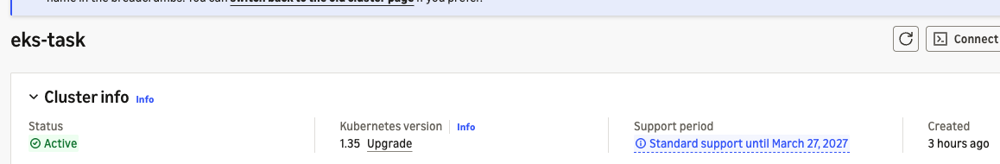 | 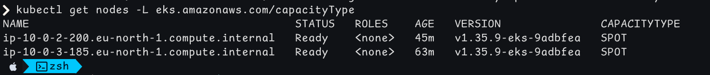 | 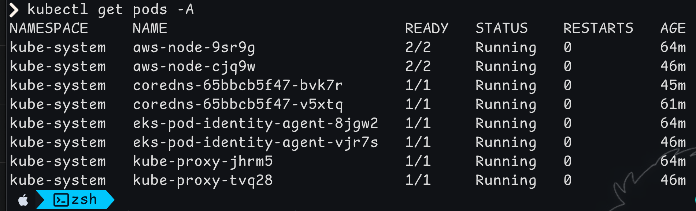 | 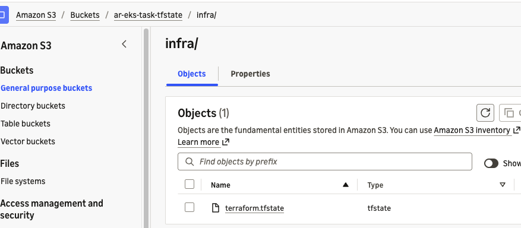 |

## Application deployment

Code: [app](app), [charts/demo-app](charts/demo-app), [terraform/platform](terraform/platform).

A small FastAPI service with four endpoints: `/` (hello), `/healthz` (probes), `/work?ms=N` (burns time, used for alerts and load tests) and `/metrics` (Prometheus).

The Helm chart has 2 replicas spread across nodes, probes on `/healthz`, requests and limits (100m to 500m CPU, 128 to 256 MiB), a restricted security context and an optional `ServiceMonitor`. It is deployed by a `helm_release` in the `platform` layer. The ECR repository (scan on push) lives in `infra`, because the image must exist before the release.

| Build and push | ECR repository | Pods |
|---|---|---|
| 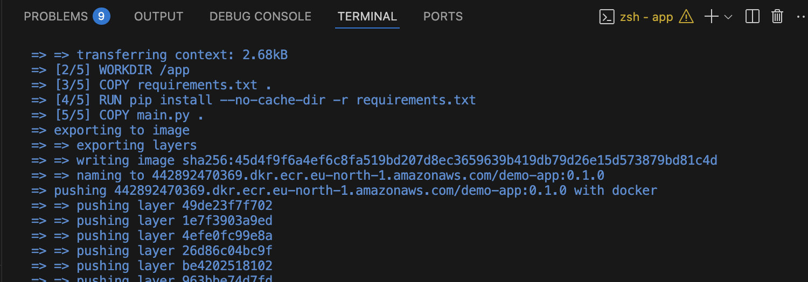 | 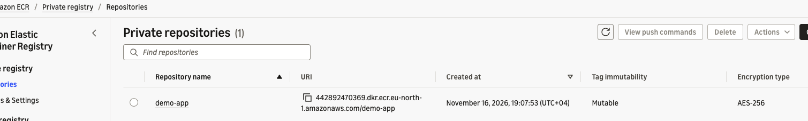 | 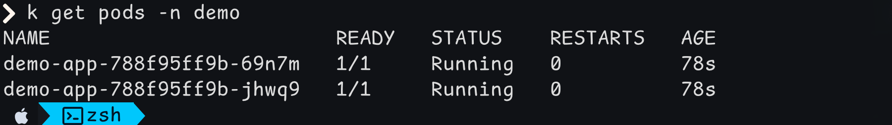 |

## Monitoring and logging

Code: [terraform/platform](terraform/platform) (values in `values/`), [charts/app-dashboard](charts/app-dashboard).

| Component | Chart | Role |
|---|---|---|
| kube-prometheus-stack 93.3.0 | `prometheus-community` | Prometheus, Grafana, kube-state-metrics, node-exporter |
| Loki 6.55.0 | `grafana-community` | log storage, single-binary mode |
| Alloy 1.16.0 | `grafana` | log collector, replaces the end-of-life Promtail |

- **Metrics:** a `ServiceMonitor` makes Prometheus scrape `/metrics` every 15 s. CPU and memory come from cAdvisor and kube-state-metrics.
- **Logs:** Alloy reads pod logs through the Kubernetes API, adds labels (`namespace`, `pod`, `container`, `app`) and pushes them to Loki, a second Grafana data source.
- The chart also ships ready-made Kubernetes dashboards (Compute Resources, Node Exporter, Kubelet) that cover the app too.

Grafana is reached with `kubectl port-forward -n monitoring svc/kube-prometheus-stack-grafana 3000:80`.

| Demo App dashboard | Dashboard, logs | Ready-made dashboards | Prometheus target |
|---|---|---|---|
| 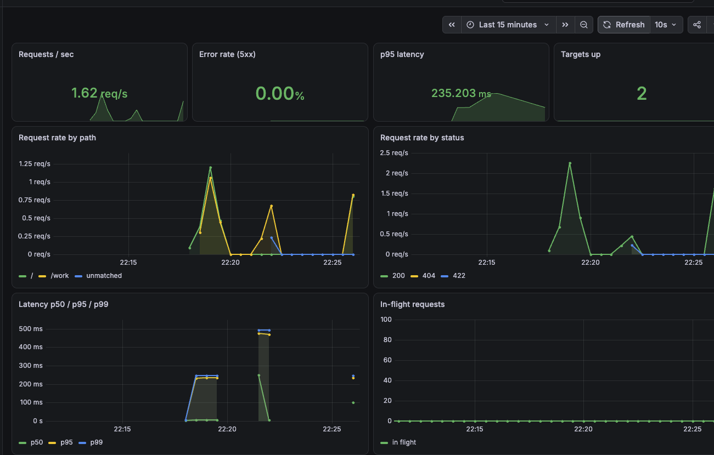 | 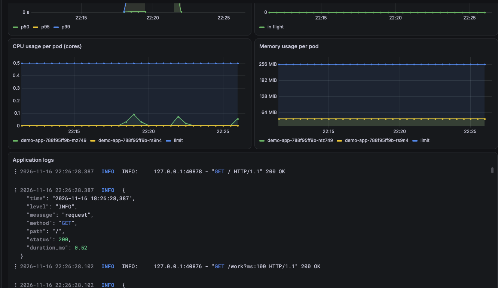 | 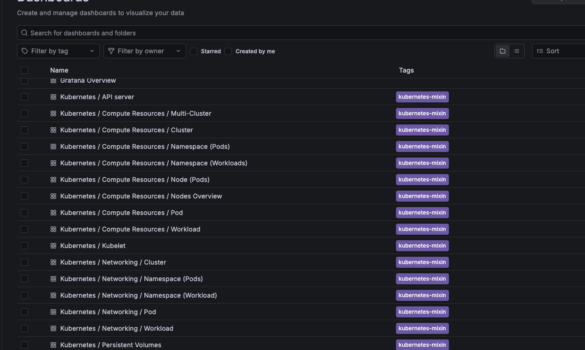 | 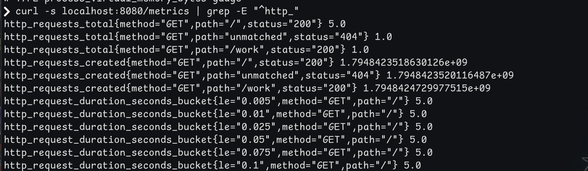 |

## Alerting

Code: [terraform/infra/secrets.tf](terraform/infra/secrets.tf), [charts/secrets-config](charts/secrets-config), [kube-prometheus-stack.yaml](terraform/platform/values/kube-prometheus-stack.yaml).

**Secrets never touch git or Terraform state.** They live in AWS Secrets Manager and are synced into the cluster:

1. Terraform (`infra`) creates an IAM role that can only read `eks-task/*`, linked to the External Secrets service account through Pod Identity.
2. The External Secrets Operator reads the secret and creates the Kubernetes Secret `grafana-secrets`.
3. Grafana uses it for the admin login, and the webhook becomes the variable `SLACK_WEBHOOK_URL` used by the Slack contact point.

| Alert | Condition | Pending period |
|---|---|---|
| High CPU usage | pod CPU above 80% of its limit | 2 minutes |
| High memory usage | pod memory above 80% of its limit | 2 minutes |

To trigger the CPU alert, run sustained load against `/work` (needs `kubectl port-forward -n demo svc/demo-app 8080:80`):

```bash
for i in 1 2 3 4; do (for j in $(seq 1 150); do curl -s "localhost:8080/work?ms=1000" > /dev/null; done) & done; wait
```

The rule goes Pending, then Firing, and a message arrives in Slack. The memory alert is hard to trigger with this app (about 14% of its limit), so it was only verified as a loaded rule.

| ExternalSecret synced | Testing the alert | Firing in Grafana | Message in Slack |
|---|---|---|---|
| 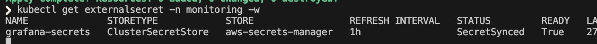 | 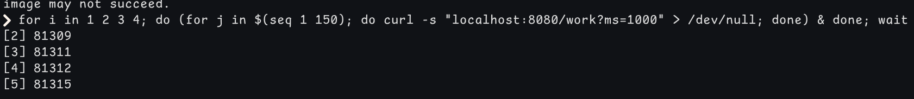 | 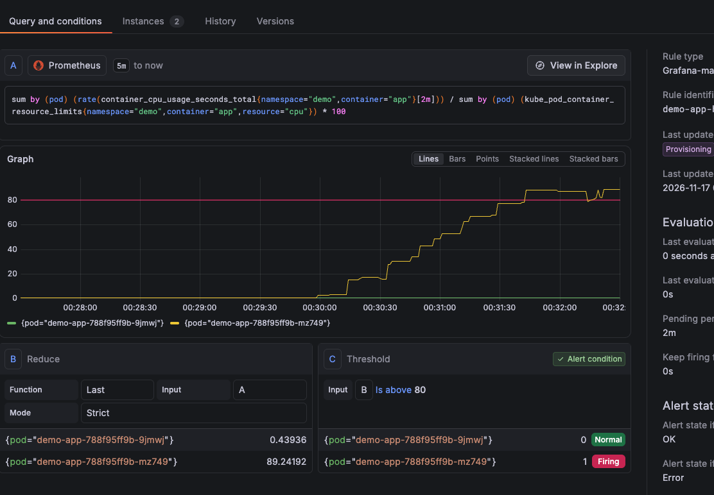 | 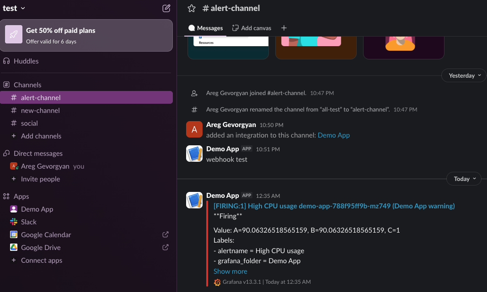 |

## Public access

Code: [lb-controller.tf](terraform/infra/lb-controller.tf), [public-access.tf](terraform/platform/public-access.tf), [ingress.yaml](charts/demo-app/templates/ingress.yaml).

```text
Internet --> ALB (public subnets, :80) --> pod IPs (private subnets, :8080)
                 ^ created from the Ingress by the AWS Load Balancer Controller
Route 53 health check --> http://<alb-dns>/healthz   (every 30 s, from outside the VPC)
```

1. **IAM (`infra`):** a role with the controller's published IAM policy, linked to its service account through Pod Identity. Download the policy once, using the same version as the chart:
   ```bash
   curl -o terraform/infra/lb-controller-iam-policy.json \
     https://raw.githubusercontent.com/kubernetes-sigs/aws-load-balancer-controller/v3.6.3/docs/install/iam_policy.json
   ```
2. **Controller (`platform`):** a `helm_release` (chart 3.6.3) in `kube-system`. The subnets carry the `kubernetes.io/role/elb` tag, so it finds the public ones itself.
3. **Ingress:** part of the `demo-app` chart: `internet-facing`, `target-type: ip`, health check on `/healthz`, fixed ALB name so Terraform can look it up.
4. **External health check:** an `aws_route53_health_check` on `/healthz` of the ALB address. Route 53 probes from outside AWS, so it catches failures the in-cluster probes cannot.

Check it: `curl -i "$(terraform -chdir=terraform/platform output -raw app_url)/healthz"`

**Differences from the task:**

- **No custom domain, no HTTPS.** The Free plan cannot register domains, and ACM does not issue certificates for `*.elb.amazonaws.com`, so the app is reached on the ALB's AWS address over HTTP.
- **No CloudWatch alarm on the health check.** Route 53 metrics exist only in `us-east-1`, and the organization policy allows only `eu-north-1`.
- The policy also denies `shield:*`, so the controller logs an error and skips Shield. Harmless.

| Application Load Balancer | Route 53 health check |
|---|---|
| 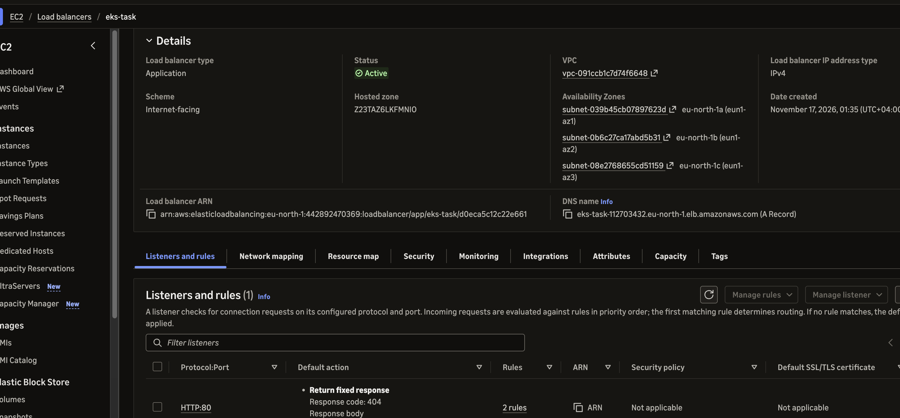 | 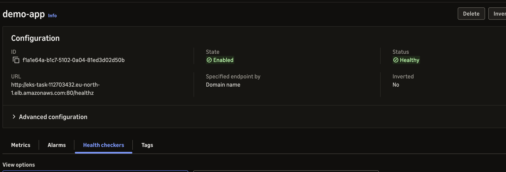 |

## Load testing

Code: [loadtest](loadtest).

[k6](https://k6.io) 2.3.0 runs **inside the cluster** as a Kubernetes Job against the app's Service. From a laptop through `kubectl port-forward` it would measure the tunnel, not the app.

- Executor `constant-arrival-rate`: a fixed request rate whatever the response time.
- Stages of 50, 100, 150, 200, 300 and 400 requests per second, 60 s each, 15 s apart.
- Traffic mix: 80% `GET /`, 20% `GET /work?ms=20`. Thresholds per stage: p95 under 500 ms, errors under 1%.

```bash
kubectl create configmap k6-script --from-file=loadtest/script.js -n demo
kubectl apply -f loadtest/job.yaml
kubectl logs -f job/k6 -n demo
```

**Results:** one run of about 7.5 minutes, 66,608 requests, default app settings (2 replicas, 0.5 CPU limit each).

| Target rate | Requests | Achieved rate | Median | p95 | Error rate |
|---|---|---|---|---|---|
| 50 rps | 3,001 | 50 rps | 2.8 ms | 23.6 ms | 0% |
| 100 rps | 6,000 | 100 rps | 2.7 ms | 30.2 ms | 0% |
| 150 rps | 9,000 | 150 rps | 4.1 ms | 64.7 ms | 0% |
| 200 rps | 12,000 | 200 rps | 20.6 ms | 101 ms | 0% |
| 300 rps | 17,993 | 300 rps | 104 ms | 286 ms | 0% |
| 400 rps | 18,614 | about 310 rps | 2.78 s | 9.91 s | 0.12% (23 requests) |

At 400 rps k6 also dropped 5,395 requests (about 22% of the target), because all 2,000 virtual users were already waiting on slow responses.

| k6 summary | Dashboard, first stages | Dashboard, a few minutes later |
|---|---|---|
| 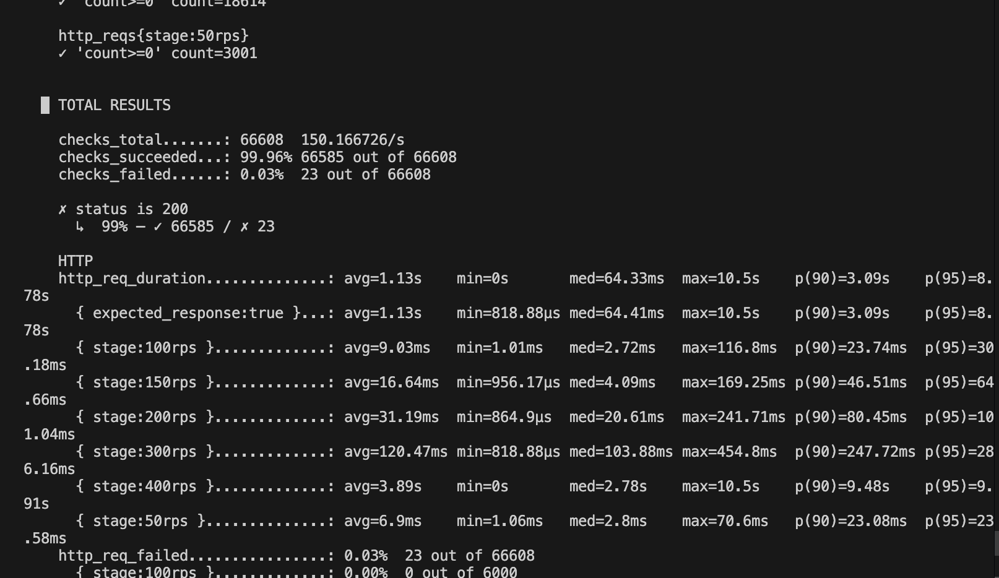 | 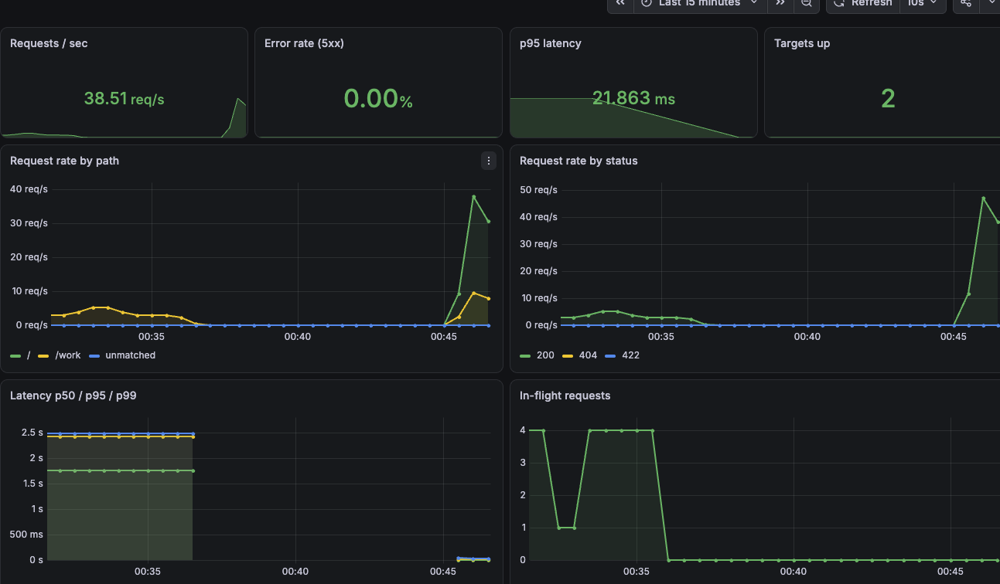 | 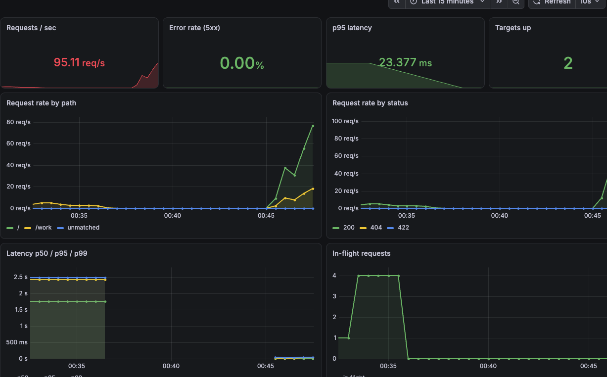 |

**Observations**

- **Up to 200 rps the app is comfortable** (p95 around 100 ms, no errors). Latency climbs from about 150 rps, and at 300 rps the p95 is 286 ms, still under the 500 ms threshold but with little headroom.
- **It breaks between 300 and 400 rps:** the app serves about 310 rps, requests queue, p95 reaches almost 10 s and errors appear. The practical ceiling of the default setup is about **300 rps**.
- **The likely limit is the CPU limit and the single Python process, not the network.** This is an inference, not confirmed from the CPU panel. The CPU alert did not fire, most likely because each stage lasts 60 s, less than the alert's 2-minute pending period. The sustained load in the Alerting section did fire it.
- **Caveats:** k6 shared the two nodes with the app, `/work` burns wall-clock time and not exact CPU, and this is a single run, so the numbers are indicative.

**Improvements:** more than one uvicorn worker and a higher CPU limit, a Horizontal Pod Autoscaler on CPU, less per-request logging, a separate node for the load generator, a PodDisruptionBudget and more Spot instance types.

## Limitations

- **No persistent storage:** Prometheus, Loki and Grafana use no volumes, so metrics and logs are lost if a pod is rescheduled. Production would add the EBS CSI driver and `gp3` volumes.
- **One Spot pool and one NAT gateway:** cheaper, but Spot interruptions and a NAT failure hit harder.
- **Long-lived IAM user key:** fine for a short-lived sandbox. A real setup would use SSO and short-lived credentials.
- **Demo-sized monitoring:** two-day retention, single Alloy and Loki replicas.
- **HTTP only, no custom domain**, see Public access.

## What could be added

- **Custom domain and HTTPS:** a Route 53 hosted zone, an ACM certificate validated by DNS, an alias record to the ALB, an HTTPS listener with an HTTP redirect, and the health check on `https://`. Plus a CloudWatch alarm on the health check if `us-east-1` is allowed.
- **Load test through the public load balancer**, from outside the cluster.
- **Checkov** on the Dockerfile and the Terraform and Helm code, and **Trivy** on the built image, ideally in CI (ECR scan on push is already enabled).
- CI running `fmt`, `validate` and `plan` on pull requests, an AWS Budgets alert, and a Spot interruption handler.

